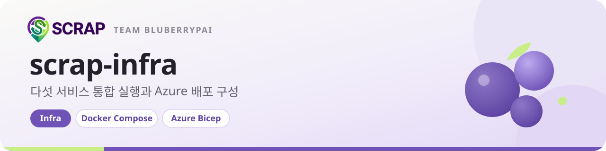

<div align="center">



<br>


[로컬 통합 실행](#로컬-통합-실행) · [.env 값](#env에-채울-값) · [데이터 적재](#처리-경로-데이터-적재) · [Azure 배포](docs/deploy-azure.md) · [시험 VM](docs/deploy-single-vm.md)

</div>

SCRAP의 **infra** 레포. 다섯 서비스를 한 번에 띄우는 통합 compose, Azure 리소스 정의(Bicep)와 배포 스크립트, 함께 배포할 버전 조합의 검증 기록을 담당함.

- 하지 않는 일: 서비스 코드
- 팀 공통 규칙: 조직 `.github` 레포의 [CONTRIBUTING.md](https://github.com/BluberrypAI/.github/blob/main/CONTRIBUTING.md)

## 서비스 구성

```
브라우저 ──▶ web ──/api──▶ server ──▶ diagnosis (문진·분류 판정)  ──▶ diagnosis-db
            (nginx)          │    └──▶ route     (업체 AI 검토·웹 조사)
                             └──▶ server-db
```

| 서비스 | 레포 | 로컬 주소 | 비고 |
| --- | --- | --- | --- |
| web | scrap-web | http://localhost:5178 | nginx. `/api`를 server로 전달 |
| server | scrap-server | http://localhost:8000/docs | 시작할 때 마이그레이션 자동 적용. diagnosis·route의 `/health`가 성공한 뒤 시작 |
| diagnosis | scrap-diagnosis | http://localhost:8030/docs | 확인용. server는 내부망 주소로 부름 |
| route | scrap-route | http://localhost:8010/docs | 확인용. server는 내부망 주소로 부름 |
| server-db, diagnosis-db | - | 내부망 전용 | PostgreSQL 17. 데이터는 Docker 볼륨에 남음 |
| server-seed | scrap-server | - | `seed` 프로필. 공정 참조 데이터 적재용 일회성 작업 |

## 로컬 폴더 구성

다른 레포를 이 레포 **안이 아니라 옆에** clone함. 통합 compose는 형제 폴더를 빌드 경로로 사용함. 폴더 이름이 다르면 `.env`의 `*_DIR`을 바꿈.

```
resource-ai/
├─ scrap-web/         # 화면
├─ scrap-server/      # API, 인증, 기업 정보, 인계 기록
├─ scrap-diagnosis/   # 문진 엔진
├─ scrap-route/       # 업체 AI 검토
└─ scrap-infra/       # 이 레포
```

## 로컬 통합 실행

Docker Desktop만 있으면 됨. 배포와 같은 빌드 이미지로 띄움 (코드를 고치면 `--build`로 다시 빌드).

```bash
cp .env.example .env                  # 토큰·키 값 채우기 (아래 표)
docker compose up -d --build          # 전체 빌드·실행
docker compose run --rm server-seed   # 처음 한 번: 처리 경로 공정 참조 데이터 적재
```

> [!IMPORTANT]
> 브라우저에서 **http://localhost:5178** 을 엶 (`127.0.0.1`이 아니라 `localhost`, 소셜 로그인 쿠키 때문). `VITE_ENABLE_DEV_LOGIN=true`면 로그인 화면의 "개발용 로그인"으로 OAuth 키 없이 들어갈 수 있음.

### 자주 쓰는 명령

```bash
docker compose ps                            # 상태
docker compose logs -f server                # 로그
docker compose up -d --build --no-deps web   # 의존 서비스를 유지하고 web만 다시 빌드
docker compose down                          # 중지 (데이터 유지)
docker compose down -v                       # 중지 + DB 데이터 삭제
```

### .env에 채울 값

| 값 | 없으면 |
| --- | --- |
| `ENGINE_SERVICE_TOKEN`, `SCRAP_INTAKE_SERVICE_TOKEN` | 로컬 기본값으로 동작. 한쪽만 정하면 양쪽 서비스에 같이 들어감. 영문·숫자만 사용 (한글이 섞이면 server 요청이 500) |
| `DIAGNOSIS_AZURE_OPENAI_*` | 문진이 자유 문장을 못 알아듣고 선택지 버튼으로만 진행 (`DIAGNOSIS_LLM_PROVIDER=off`와 같음) |
| `DIAGNOSIS_ALLOW_DOCUMENT_OCR`, `DIAGNOSIS_AZURE_DOCINTEL_*` | 시험성적서 **스캔본·사진**을 읽지 못함 (글자 있는 PDF는 읽음). 켜면 문서 이미지가 Azure Document Intelligence로 가고 쪽마다 과금 |
| `ROUTE_AZURE_OPENAI_*` | 업체 AI 검토·웹 조사가 "미완료"로 남아 인수 요청을 보낼 수 없음 |
| `VITE_KAKAO_MAP_APP_KEY` | 카카오 지도 대신 MapLibre 지도 표시. **JavaScript 키**만 넣고, 카카오 콘솔에서 카카오맵 사용 ON과 SDK 도메인(`http://localhost:5178`, 운영 도메인) 등록 필요 |
| `VITE_MAPBOX_ACCESS_TOKEN` | MapLibre 지도가 OpenStreetMap 타일 사용 |
| `KAKAO_MOBILITY_REST_API_KEY` | 도로거리를 조회하지 않고 도로거리 미확인·직선거리로 표시. 서버 전용 REST 키이며 VITE 변수에 넣지 않음 |
| `GOOGLE_*`, `MICROSOFT_*` | 소셜 로그인 불가. 개발용 로그인은 가능 |

`VITE_*`는 web 빌드 때 들어가므로 바꾸면 `docker compose up -d --build web`으로 반영함.

### 대기 시간 맞추기

문진 모델의 응답을 기다리다가 server가 먼저 끊지 않도록 로컬은 `DIAGNOSIS_LLM_TIMEOUT_SECONDS=60`, `DIAGNOSIS_ENGINE_TIMEOUT_SECONDS=300`을 기본으로 연결함 (추출·응답 각 최대 2회 × 60초 = 240초 + 규칙·DB 여유). 모델 대기를 늘리면 server 대기도 **모델 대기 × 4 + 여유** 이상으로 맞춤. web nginx의 대기는 600초.

Azure 운영은 App Service 요청 상한(약 230초)과 Front Door 출처 응답 대기(최대 240초) 때문에 모델 40초(4회 160초), server 200초, Front Door 240초를 씀. Bicep 파라미터 `diagnosisLlmTimeoutSeconds`, `diagnosisEngineTimeoutSeconds`로 바꿀 수 있음.

### 도로거리 (선택)

| 방법 | 설정 | 비고 |
| --- | --- | --- |
| 카카오모빌리티 | `KAKAO_MOBILITY_REST_API_KEY` | 우선 사용. 자동차 길찾기 활성화된 REST 키 |
| 공개 OSRM | `OSRM_DEMO_ENABLED=true` | 키 없는 시연용. 단일 워커·초당 1회·24시간 캐시. 운영·대규모 트래픽에는 자체 경로 서버 필요 |

설정 후 `docker compose up -d --force-recreate --no-deps server`로 반영하고, 기존 물량은 **다시 검토**해야 저장된 거리가 갱신됨. 기본 자동차 경로이므로 화물차 통행 제한·운송 견적을 대신하지 않음.

## 처리 경로 데이터 적재

`server-seed`는 실행할 때마다 공정 참조 데이터를 **갈아끼움**. 전국 명부까지 넣으려면 명부 JSON을 `data/`(또는 `REGISTRY_DIR`)에 두고 함께 넣음.

```bash
docker compose run --rm server-seed sh -c "alembic upgrade head && python -m app.domains.treatment.import_catalog --registry /registry/<파일명>.json --sha256 <SHA-256>"
```

명부 원본과 SHA-256은 scrap-server `backend/README.md`의 "처리 경로 데이터 적재" 참고.

> [!NOTE]
> scrap-route의 Neo4j(지식그래프 `/kg/*`)와 pgvector(법령 검색 `/rag/*`)는 띄우지 않음. 지금 server가 부르는 route API(`/treatment/intake-reviews`, `/treatment/facility-web-search`)는 둘 다 쓰지 않음.

## 배포

| 환경 | 구성 | 배포 방법 | 문서 |
| --- | --- | --- | --- |
| **Azure 운영** | Front Door(WAF) → App Service 플랜 하나에 앱 4개(web·server·diagnosis·route), VNet 안 DB VM(PostgreSQL 17), Key Vault, ACR, NAT 게이트웨이. 모두 Korea Central | 각 서비스 레포 main 병합 → ACR `:main` push → ACR 웹훅으로 앱 재시작. 리소스는 `deploy/azure/deploy.sh core · secrets · apps` | [docs/deploy-azure.md](docs/deploy-azure.md) |
| 단일 VM 시험 | `compose.deploy.yaml`을 겹쳐 caddy(HTTPS·팀 비밀번호)만 바깥에 열고 개발용 로그인 사용 | Actions → **Deploy VM**에서 브랜치를 골라 수동 실행 (자동 배포 없음) | [docs/deploy-single-vm.md](docs/deploy-single-vm.md) |

```
azure/main.bicep            # Azure 리소스 전체 (모듈: azure/modules/webapp.bicep)
deploy/azure/deploy.sh      # core · secrets · apps · images 단계 실행
deploy/update.sh            # 시험 VM에서 레포 갱신·재빌드
deploy/Caddyfile            # 시험 VM의 HTTPS·기본 인증
compose.yaml                # 로컬 통합 실행 (배포 구성의 기준)
compose.deploy.yaml         # 시험 VM 덮어쓰기
```

CI([ci.yml](.github/workflows/ci.yml))는 compose 파일 문법과 Bicep 빌드를 검사함.

## 검증 기록

| 문서 | 내용 |
| --- | --- |
| [docs/final-integration-20261118.md](docs/final-integration-20261118.md) | 팀원 최종 통합본: 레포 조합, 문진 → QR → 완료 검증 |
| [docs/review-progress-verification-20261119.md](docs/review-progress-verification-20261119.md) | 거리순 업체 검토 작업·진행 조회 실호출 (적용 순서: route → server → web) |
| [docs/local-e2e-20261117.md](docs/local-e2e-20261117.md) | 로컬 로그인·PP 인계 E2E |
| [docs/local-team-integration-20261118.md](docs/local-team-integration-20261118.md), [docs/pp-demo-scenarios-20261118.md](docs/pp-demo-scenarios-20261118.md) | 팀 통합 실행, PP 시연 시나리오 |

## 브랜치

작업 브랜치 → `develop` (PR, CI 통과 후 작성자가 병합) → `main` (배포, 서버 담당자)
